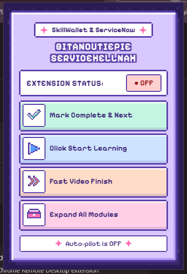
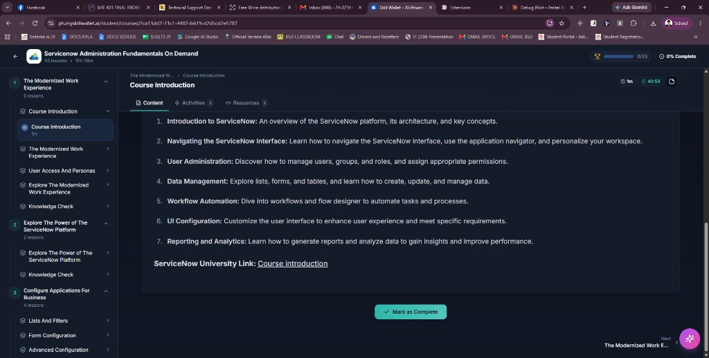
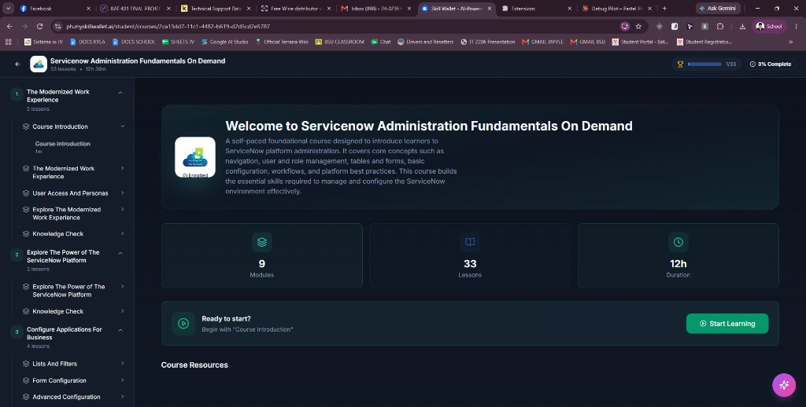
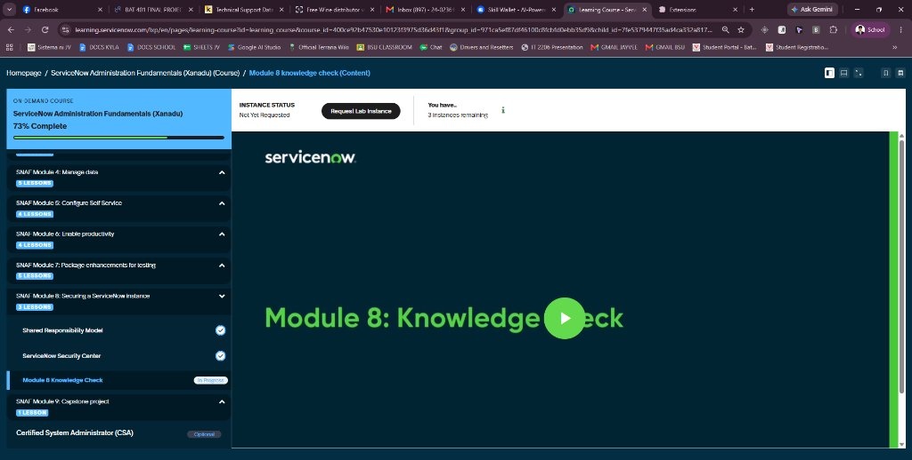

<div align="center">
  
  <h1>SERVICE HELL NAH</h1>
  <p><b>Automated Course Pilot &amp; Fast-Finisher for ServiceNow Now Learning and SkillWallet</b></p>
</div>

---

An automation and productivity Chrome Extension designed for corporate learning portals, specifically tailored for **ServiceNow Now Learning** (`learning.servicenow.com`) and **SkillWallet** (`myskillwallet.ai`).

The extension automates progress tracking, lesson completion, video fast-finishing, and module navigation through a retro pastel-pixel debugging dashboard.

---

## Screenshots

<div align="center">
  <h3>Interactive Extension Control Panel</h3>
  
  <br/><br/>
  <h3>SkillWallet Automation (Mark Complete &amp; Next Flow)</h3>
  
  <br/><br/>
  <h3>SkillWallet Course Onboarding Flow</h3>
  
  <br/><br/>
  <h3>ServiceNow Knowledge Checks &amp; Video Skip</h3>
  
</div>

---

## Key Features

- **Automated Video Fast-Finishing**: Detects Video.js and native HTML5 video players, speeds playback up to 16x, seeks to the finish boundary, and safely dispatches LMS events (`timeupdate`, `ended`) so completion checkmarks register without breaking platform player states.
- **SkillWallet Auto-Pilot**: Automatically triggers the initial *Start Learning* flow, marks reading & content units as complete, and auto-advances through subsequent modules via contextual next controls and sidebar fallbacks.
- **ServiceNow Module Auto-Expansion**: Recursively detects and expands collapsed accordion modules, auto-progressing through all child subparts and knowledge checks.
- **Master ON / OFF State**: Starts in a passive `OFF` state by default to prevent unintentional automated actions upon page load. Persists user state across sessions via `chrome.storage.local`.
- **Lightweight Pastel Pixel Dashboard**: Built using pixel typography (`Pixelify Sans`), custom SVG-rendered retro pixel art icons, interactive state indicators, and manual debug triggers.
- **Network Bloat Neutralizer**: Neutralizes heavyweight third-party trackers and telemetry (WalkMe, Pendo, Hotjar, FullStory, Appcues) to improve page performance and eliminate lag.

---

## Architecture

```
├── manifest.json       # Manifest V3 extension configuration
├── content.js          # Isolated-world orchestrator (SkillWallet, ServiceNow navigation, master switches)
├── inject.js           # Main-world script for interacting with Video.js, HTMLMediaElement, and SCORM/LMS APIs
├── popup.html          # Pastel Pixel dashboard UI
├── popup.js            # Pixel icon generator, toggle listener, and message dispatcher
├── rules.json          # DeclarativeNetRequest rules for blocking analytics and telemetry
└── docs/assets/        # Screenshots, badges, and project icons
```

### Context Separation

- **Content Script (`content.js`)**: Runs in an isolated extension environment. Handles DOM inspection, mouse simulations (`mousedown`, `mouseup`, `click`), state synchronization via `chrome.storage.local`, and communication with the extension popup.
- **Page Inject (`inject.js`)**: Injected into the document's `MAIN` world to access `window.videojs`, HTMLMediaElement prototypes, and portal-specific global APIs without security context boundaries.

---

## Installation

1. Clone or download this repository to a local folder:
   ```bash
   git clone https://github.com/bitancutiepie/service-hell-nah.git
   ```
2. Open Google Chrome (or any Chromium-based browser) and navigate to `chrome://extensions/`.
3. Enable **Developer mode** using the toggle in the upper-right corner.
4. Click **Load unpacked** in the top-left corner.
5. Select the project directory (`video-skip-extension`).

---

## Usage

1. Open your course on **ServiceNow Now Learning** or **SkillWallet**.
2. Click the extension icon in your browser toolbar to open the control panel.
3. Toggle the **EXTENSION STATUS** button:
   - **`● OFF`** (Default): Passive mode. No automated actions are taken on page loads or refreshes.
   - **`● ON`**: Active auto-pilot. Automatically completes the current item, advances to the next section, and expands module accordions.

### Manual Actions

Even when auto-pilot is turned `OFF`, individual actions can be manually dispatched from the popup:

| Button | Target Portal | Action Description |
| :--- | :--- | :--- |
| **Mark Complete & Next** | SkillWallet | Triggers the *Mark as Complete* button, waits for API acknowledgement, and advances. |
| **Click Start Learning** | SkillWallet | Clicks the course entry CTA on introduction pages. |
| **Fast Video Finish** | Both | Forces video playback, seeks to end boundary, and dispatches completion events. |
| **Expand All Modules** | ServiceNow | Recursively expands all collapsed module accordions in the sidebar. |

---

> [!NOTE]
> On platforms utilizing SCORM or xAPI standards, completion triggers automatically call `cmi.core.lesson_status = "completed"` and invoke `Commit()` when available.

> [!IMPORTANT]
> The extension respects platform rate limits by including asynchronous delays (1.2s - 2.5s) between state checks and module transitions to ensure backend progress persistence.
